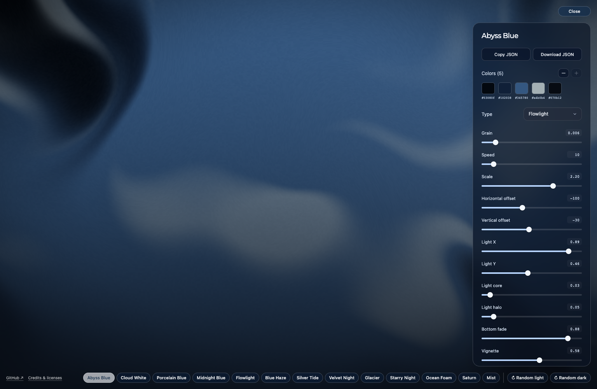
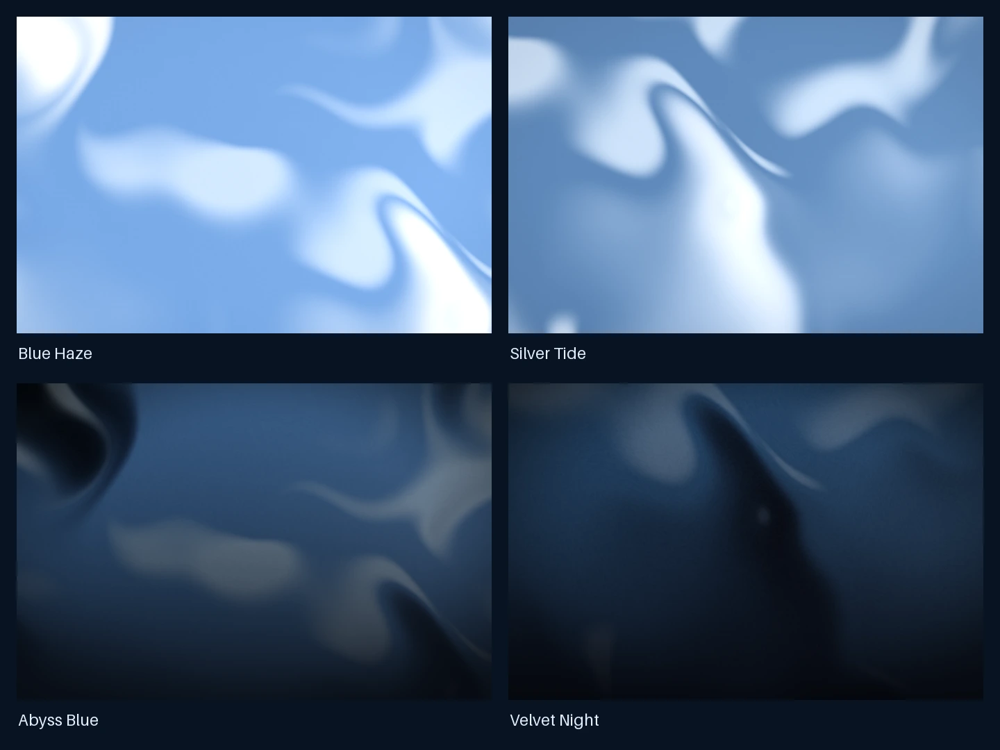
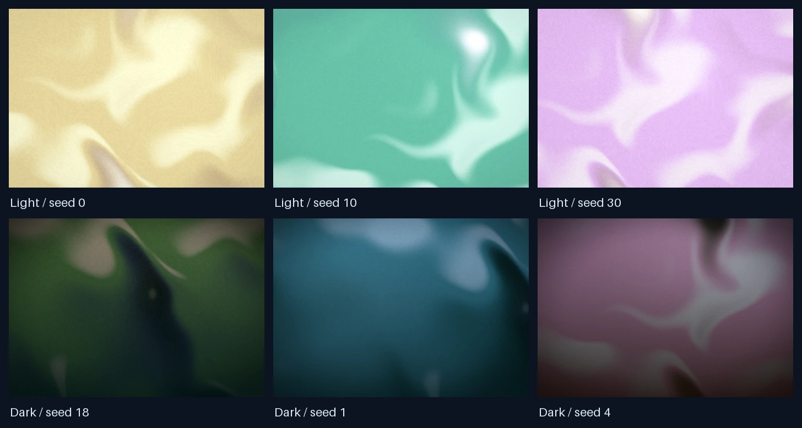

# Shader Animation Generator

A browser-based editor for flowing gradients, soft atmospheres and fluid backgrounds. Built with React, TypeScript, Vite and WebGL 2. No backend, account or API key required.



## Run locally

Requires Node.js 22.12+ and npm.

```sh
npm ci
npm run dev
```

Open **http://127.0.0.1:5173**.

```sh
npm run build      # Type-check and build a static bundle
npm run preview    # Preview at http://127.0.0.1:4173
npm run typecheck
```

Deploy the generated `dist/` directory to a static host. The build uses a relative base for subdirectory hosting and includes third-party licenses. No automatic website deployment is configured.

## Features

- Three renderers: **Pattern**, **Fluid** and **Flowlight**.
- Thirteen presets with editable colors, motion, scale and grain.
- Flowlight adds soft lighting, bloom, vignette and optional bottom fade.
- Compact bottom-right preset strip, aligned with the footer links, with horizontal scrolling on narrow screens.
- **Customize** opens the controls; **Close** hides them.
- **Random light / Random dark** generates style-constrained palette variations locally.
- Copy, view or download a complete JSON parameter object. Copy first uses the Clipboard API, then a legacy compatibility path; if both are blocked, the editor opens and selects the JSON for manual copying.
- No analytics, tracking, remote fonts, cookies or API calls in normal operation.

## Presets

| Preset | Style |
| --- | --- |
| Abyss Blue (default) | Navy depths with muted silver light |
| Cloud White | Almost-white folds with a soft powder-blue tint |
| Porcelain Blue | Soft blue and white |
| Midnight Blue | Inky blue and black |
| Flowlight | Deep blue and warm gold, soft light and subtle bloom |
| Blue Haze | Pale blue-white haze |
| Silver Tide | Silver highlights over cool blue folds |
| Velvet Night | Velvety blue and near-black shadows |
| Glacier | Cold blue and teal |
| Starry Night | Indigo and gold |
| Ocean Foam | Ocean blue and pale foam |
| Saturn | Muted blue-green atmosphere |
| Mist | Powder blue and cloudy white |



## Random color design

Random palettes are generated from scratch across the entire hue wheel, not sampled from the curated presets. Analogous, split-complementary, soft triadic and complementary duotone relationships combine a dominant color with quieter shadows and highlights.

The generator uses [OKLCH](https://developer.mozilla.org/en-US/docs/Web/CSS/Reference/Values/color_value/oklch) to control perceived lightness, chroma and hue separately. Chroma is capped at 0.105 and reduced further for dark colors; colors outside sRGB are mapped by reducing chroma while preserving lightness and hue. This creates broader rose, clay, ochre, sage, teal and violet possibilities without neon-like saturation. Light/dark modes use distinct lightness ranges, and both keep scale fixed at 2.

These are design heuristics rather than a guarantee that every random result will suit every use. Randomization runs entirely locally; no palette API or external content is requested at runtime.



## JSON and reusable rendering

Each random variation has a seed shown in the status message. The exported JSON contains all parameters, so the seed is not required to retain a palette. Seeded generation is also available programmatically:

```ts
import { generateVariant } from './src/randomize'
const parameters = generateVariant(42, 'light')
```

The renderer can be reused in a React app alongside its fragment module and canvas utilities:

```tsx
import { ShaderGradient } from './src/components/ShaderGradient'
import { FLOWLIGHT_PRESET } from './src/presets'

export function Background() {
  return (
    <div style={{ position: 'relative', width: '100%', height: 600 }}>
      <ShaderGradient {...FLOWLIGHT_PRESET} />
    </div>
  )
}
```

Pattern accepts 1–6 colors; Fluid and Flowlight accept 1–5. Missing Fluid slots render as black; missing Flowlight slots repeat the final color. Controls only appear for parameters used by the current renderer. Animation phase is time-based, so JSON preserves settings rather than a particular frame. Output may vary with viewport size and GPU precision. JSON import and image/video export are not currently included.

## Tests

```sh
npx playwright install chromium
npm run build
npm test
```

To use an installed Google Chrome instead:

```sh
PLAYWRIGHT_CHANNEL=chrome npm test
```

Tests cover seeded generation, shader compilation and non-uniform pixel output, controls, exports, resizing, minimal UI and failure fallbacks.

## Credits

Selected shader visual styles co-created with [@yixiangihsiang](https://github.com/yixiangihsiang).

部分 shader 视觉风格由 [@yixiangihsiang](https://github.com/yixiangihsiang) 共同创作。

## Licenses

Project-owned code is [MIT-licensed](LICENSE). Third-party portions retain their original licenses:

- The Pattern renderer adapts [Paper Shaders' Warp](https://github.com/paper-design/shaders), under **Apache-2.0**. Modifications include color blending, grain, uniform mapping and React integration. Powered by [Paper Shaders](https://shaders.paper.design).
- The fluid noise functions derive from [Ashima Arts / Stefan Gustavson's webgl-noise](https://github.com/ashima/webgl-noise), under **MIT**.
- React, React DOM and Scheduler are **MIT**-licensed.
- The locally bundled [Montserrat](https://github.com/JulietaUla/Montserrat) Medium font is licensed under **SIL Open Font License 1.1** and used only for panel headings.
- David Hoskins' [Hash without Sine](https://www.shadertoy.com/view/4djSRW) grain hash is **MIT**-licensed; the full notice is preserved.
- Mulberry32 credits Tommy Ettinger's **CC0/public-domain** algorithm and bryc's JavaScript implementation under its **MIT fallback** license.
- Vite/Rolldown-generated runtime helpers retain their **MIT** notices.

Full license texts and attribution are in [third-party notices](public/THIRD_PARTY_NOTICES.txt) and [NOTICE](NOTICE). Keep these notices when redistributing the code or static build. No trademark rights are granted.

## 中文说明

一个可独立运行的 WebGL shader 编辑器：调色、控制流速和颗粒、调整柔光与暗角，并复制或下载 JSON 参数。不需要后端或 API Key。

- 使用 `npm ci && npm run dev` 启动。
- 右下角为紧凑的预设栏，与底部链接对齐，窄屏可横向滚动。
- 点击 **Customize** 打开参数面板，点击 **Close** 收起。
- **Random light / Random dark** 在浅色、深色风格内随机生成变体。
- 所有渲染和随机生成均在本地浏览器中完成。
- 项目代码采用 MIT；第三方部分保留其 Apache-2.0 / MIT / SIL OFL 1.1 许可证、CC0 公有领域声明及署名。
